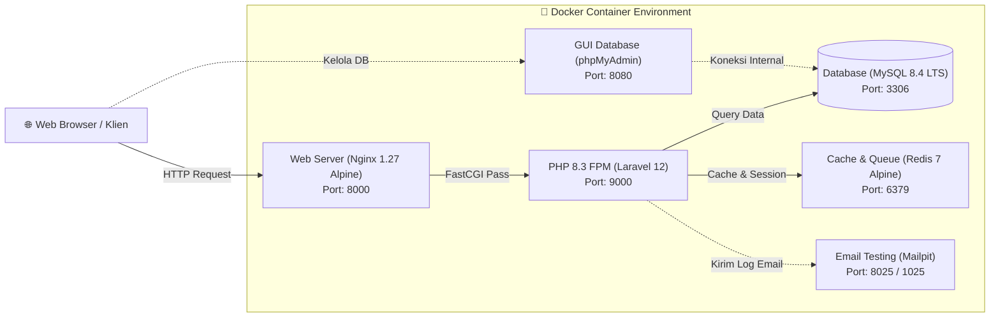

<div align="center">


# E-Surat BPKAD — Sistem Informasi Manajemen Persuratan Digital
### *Portfolio Project — Praktik Kerja Lapangan (Magang) di BPKAD Kabupaten Kuningan*

[](https://laravel.com)
[](https://www.php.net)
[](https://tailwindcss.com)
[](https://www.docker.com)
[](https://www.mysql.com)
[](LICENSE)

<p align="center">
  Aplikasi berbasis web modern untuk mendigitalkan, mencatat, mengarsipkan, serta memantau alur disposisi <b>Surat Masuk</b> dan <b>Surat Keluar</b> di lingkungan <b>Badan Pengelolaan Keuangan dan Aset Daerah (BPKAD)</b>.
</p>

[Fitur Utama](#-fitur-utama) • [Latar Belakang](#-latar-belakang--urgensi-sistem) • [Arsitektur](#-arsitektur--tech-stack) • [Cara Menjalankan](#-panduan-instalasi--menjalankan-aplikasi) • [Struktur Proyek](#-struktur-direktori-proyek) • [Tentang Pengembang](#-tentang-pengembang)

</div>

---

## 📌 Latar Belakang & Urgensi Sistem

Proses administrasi persuratan pada instansi pemerintah daerah memegang peranan krusial sebagai denyut operasional birokrasi. Selama pelaksanaan kegiatan magang di **BPKAD Kabupaten Kuningan**, teridentifikasi beberapa kendala utama dalam penanganan surat konvensional (berbasis buku agenda fisik):

1. **Pencarian Dokumen yang Memakan Waktu:** Membutuhkan waktu relatif lama untuk mencari arsip surat fisik terdahulu yang tersimpan di ordner/lemari berkas.
2. **Risiko Kerusakan & Kehilangan Fisik:** Kerentanan dokumen fisik terhadap pelapukan, kerusakan, atau terselip antar bagian.
3. **Keterbatasan Pelacakan Status & Disposisi:** Sulit memantau apakah suatu surat masuk sudah dibaca, sedang diproses, atau telah ditindaklanjuti.
4. **Penyusunan Rekapitulasi Laporan:** Proses rekapitulasi data surat untuk kebutuhan pelaporan berkala pimpinan membutuhkan input manual berulang yang rentan *human-error*.

**Solusi yang Dihadirkan:**
Sistem **E-Surat BPKAD** dirancang sebagai solusi digital terintegrasi yang memungkinkan seluruh alur persuratan (penerimaan, pengkategorian status, pengunggahan berkas digital, pencarian global instan, hingga pembuatan laporan rekap PDF) dapat diakses dengan cepat, aman, dan transparan dari satu peramban web.

---

## 🌟 Fitur Utama

### 📊 1. Dashboard Eksekutif & Statistik Real-Time
- Kartu indikator metrik penting: Total Surat Masuk, Total Surat Keluar, Surat Masuk Belum Dibaca, dan Surat Keluar Draft.
- Linimasa agenda 5 surat masuk dan 5 surat keluar terbaru untuk kemudahan pemantauan harian.

### 📥 2. Manajemen Surat Masuk
- Pencatatan komprehensif: Nomor surat, tanggal surat, tanggal diterima, instansi pengirim, perihal surat, dan keterangan tambahan.
- **Unggah Dokumen Digital:** Mendukung berkas lampiran arsip (PDF, DOC, DOCX, JPG, PNG).
- **Siklus Status Surat Masuk:** Pelacakan status terstruktur (`belum_dibaca`, `sudah_dibaca`, `diproses`, `selesai`).
- **Otomasi Status:** Status surat masuk otomatis berubah menjadi `sudah_dibaca` begitu berkas/detail dibuka pertama kali oleh petugas.

### 📤 3. Manajemen Surat Keluar
- Pencatatan surat resmi keluar: Nomor surat, tanggal surat, instansi tujuan, perihal, dan berkas arsip pendukung.
- Manajemen status surat keluar (`draft` vs `terkirim`).

### 🔍 4. Mesin Pencarian Terpadu (Global Search)
- Pencarian cerdas simultan melintasi basis data surat masuk dan surat keluar secara bersamaan.
- Mendukung penelusuran fleksibel berdasarkan nomor surat, instansi pengirim/tujuan, perihal, hingga catatan keterangan.

### 📑 5. Generator Laporan & Ekspor PDF Otomatis
- Filter periode dinamis berdasarkan rentang tanggal penerimaan / pengiriman.
- **Live Preview:** Pratinjau tabel rekapitulasi langsung di antarmuka web sebelum diunduh.
- **Ekspor Dokumen PDF Resmi:** Dibuat otomatis menggunakan engine *DomPDF* dengan tata letak kop dinas yang rapi dan siap cetak.

### 🔐 6. Keamanan & Manajemen Akun
- Autentikasi berbasis Laravel Breeze dengan enkripsi kata sandi Bcrypt.
- Proteksi CSRF Token pada seluruh transaksi form.
- Manajemen profil pengguna dan pembaruan kredensial.
- Validasi ketat MIME-type dan batas ukuran berkas upload dokumen.

---

## 🏗️ Arsitektur & Tech Stack

Sistem dibangun menggunakan arsitektur modern berstandar industri dengan pemisahan dependensi kontainer melalui Docker.



### Rincian Teknologi
| Komponen | Teknologi | Versi | Peran & Alasan Penggunaan |
| :--- | :--- | :--- | :--- |
| **Backend Framework** | **Laravel** | `12.x` | Framework PHP modern dengan arsitektur MVC yang elegan, aman, dan *maintainable*. |
| **Bahasa Pemrograman** | **PHP** | `8.3-FPM` | Runtime performa tinggi dengan fitur type-safety modern dan dukungan ekstensi lengkap. |
| **Database Engine** | **MySQL** | `8.4 LTS` | Relational Database Management System (RDBMS) standar industri dengan keandalan ACID. |
| **Web Server** | **Nginx** | `1.27 Alpine` | Server reverse proxy berbobot ringan, menangani file statis dan buffering upload berkas besar. |
| **Frontend Styling** | **Tailwind CSS** | `3.4 / 4.x` | Utility-first CSS framework untuk membangun UI yang rapi, responsif, dan konsisten. |
| **Frontend Tooling** | **Vite** | `7.x` | Bundler generasi terbaru untuk kompilasi aset super cepat dan Hot Module Replacement (HMR). |
| **Interaktivitas UI** | **Alpine.js** | `3.x` | Framework JavaScript minimalis dan reaktif untuk interaktivitas komponen modal dan dropdown. |
| **PDF Generator** | **Laravel DomPDF**| `3.1` | Pustaka rendering HTML-ke-PDF untuk pencetakan dokumen laporan rekapitulasi persuratan. |
| **DevOps / Container** | **Docker & Compose**| `Latest` | Menjamin sistem dapat dijalankan identik (*reproducible*) di semua komputer tanpa konfigurasi manual. |

---

## 🚀 Panduan Instalasi & Menjalankan Aplikasi

Sistem ini telah dilengkapi dengan kontainerisasi Docker penuh. Anda tidak perlu menginstal PHP, MySQL, Nginx, atau Composer di komputer lokal Anda.

### Prasyarat
- [Docker](https://docs.docker.com/get-docker/) & [Docker Compose](https://docs.docker.com/compose/) terpasang di sistem operasi Anda.
- *(Opsional)* `make` untuk kemudahan mengeksekusi perintah shortcut.

---

### Langkah 1: Clone Repositori
```bash
git clone https://github.com/lnbakti/e-surat-bpkad.git
cd e-surat-bpkad
```

---

### Langkah 2: Jalankan dengan Docker (1 Perintah)
Cukup jalankan perintah berikut:
```bash
make up
```
*(Atau jika tanpa `make`: `docker compose up -d`)*

> [!NOTE]
> Pada saat pertama kali dijalankan, script `entrypoint.sh` akan secara otomatis:
> 1. Menyiapkan berkas konfigurasi `.env`.
> 2. Mengunduh dependensi Composer (`composer install`).
> 3. Mengunduh pustaka npm & mengompilasi aset frontend (`npm run build`).
> 4. Mengenerate application key Laravel (`artisan key:generate`).
> 5. Membuat symbolic link berkas arsip surat (`artisan storage:link`).
> 6. Menjalankan migrasi database ke MySQL (`artisan migrate`).

---

### Langkah 3: Akses Layanan Melalui Peramban

| Antarmuka | URL | Kredensial Default | Keterangan |
| :--- | :--- | :--- | :--- |
| **Aplikasi E-Surat** | [http://localhost:8000](http://localhost:8000) | **Email:** `test@example.com`<br>**Password:** `password` | Aplikasi utama siap digunakan. |
| **phpMyAdmin** | [http://localhost:8080](http://localhost:8080) | **Server:** `db`<br>**User:** `root`<br>**Password:** `511040` | Antarmuka GUI manajemen tabel database. |
| **Mailpit (Email Test)** | [http://localhost:8025](http://localhost:8025) | *Tanpa login* | Web viewer untuk simulasi email notifikasi. |
| **Database Port** | `localhost:3306` | *Sama dengan kredensial phpMyAdmin* | Port langsung untuk koneksi via DBeaver/TablePlus. |

---

### Perintah Praktis (Makefile Cheat Sheet)

Sistem telah dilengkapi dengan `Makefile` untuk mempermudah pengelolaan harian:

```bash
# Menjalankan seluruh container di background
make up

# Mengisi data dummy / pengguna awal (seeder)
make seed

# Reset total database & migrasi ulang dengan data seeder
make fresh

# Menjalankan Vite dev server untuk mode pengembangan (Hot-Reload HMR)
make vite

# Masuk ke dalam terminal container aplikasi (bash)
make bash

# Memantau log aktivitas container secara real-time
make logs

# Menjalankan pengujian otomatis (PHPUnit Test Suite)
make test

# Mengosongkan cache aplikasi Laravel
make clean

# Menghentikan seluruh container
make down
```

---

## 📁 Struktur Direktori Proyek

```text
e-surat-bpkad/
├── app/
│   ├── Http/Controllers/     # Controller logika bisnis (SuratMasuk, SuratKeluar, Laporan, Dashboard)
│   ├── Http/Requests/        # Form Request validation (LoginRequest, ProfileRequest)
│   └── Models/               # Model Eloquent ORM (SuratMasuk, SuratKeluar, User)
├── bootstrap/                # Inisialisasi framework & providers
├── config/                   # Berkas konfigurasi aplikasi (Database, Mail, DomPDF, Session)
├── database/
│   ├── factories/            # Dummy model factory
│   ├── migrations/           # Skema tabel database (users, surat_masuk, surat_keluar, jobs)
│   └── seeders/              # Seeder inisialisasi data akun awal
├── docker/                   # Konfigurasi kustom kontainer Docker
│   ├── nginx/default.conf    # Konfigurasi reverse proxy Nginx untuk Laravel
│   ├── php/local.ini         # Konfigurasi memory limit, upload size, OPcache & zona waktu
│   └── entrypoint.sh         # Skrip otomatisasi startup, migrasi, dan build aset
├── public/
│   ├── build/                # Kompilasi aset produksi (CSS & JS via Vite)
│   ├── images/               # Aset statis & logo instansi
│   └── index.php             # Front controller HTTP entry point
├── resources/
│   ├── css/ & js/            # Source code styling Tailwind & Alpine.js
│   └── views/                # Template antarmuka Blade (Dashboard, Surat, Laporan, Auth)
├── routes/
│   ├── web.php               # Definisi endpoint routing aplikasi web
│   └── auth.php              # Rute autentikasi Laravel Breeze
├── storage/                  # Penyimpanan arsip berkas surat yang diunggah & log sistem
├── tests/                    # Pengujian otomatis Unit & Feature tests
├── .dockerignore             # Pengecualian berkas build docker
├── .env.docker               # Template environment aman untuk kontainer Docker
├── docker-compose.yml        # Orkestrasi multi-kontainer Docker
├── Dockerfile                # Image build PHP 8.3-FPM produksi
├── Makefile                  # Shortcut perintah operasional sistem
└── README.md                 # Dokumentasi resmi proyek
```

---

## 🧪 Pengujian & Jaminan Mutu (Quality Assurance)

Aplikasi telah dilengkapi dengan rangkaian pengujian otomatis (*Automated Feature & Unit Testing*) menggunakan **PHPUnit 11** untuk memastikan kehandalan alur autentikasi, otorisasi, keamanan session, dan integritas data:

```bash
make test
```

```text
   PASS  Tests\Unit\ExampleTest
  ✓ that true is true

   PASS  Tests\Feature\Auth\AuthenticationTest
  ✓ login screen can be rendered
  ✓ users can authenticate using the login screen
  ✓ users can not authenticate with invalid password
  ✓ users can logout

   PASS  Tests\Feature\Auth\EmailVerificationTest
  ✓ email verification screen can be rendered
  ✓ email can be verified

   PASS  Tests\Feature\Auth\PasswordResetTest
  ✓ reset password link screen can be rendered
  ✓ password can be reset with valid token

   PASS  Tests\Feature\ProfileTest
  ✓ profile page is displayed
  ✓ profile information can be updated
  ✓ user can delete their account

  Tests:    25 passed (62 assertions)
  Duration: 1.35s
```

---

## 👤 Tentang Pengembang

Aplikasi ini dikembangkan dan dirancang oleh:

- **Nama:** Lugas Nusa Bakti
- **GitHub:** [@lnbakti](https://github.com/lnbakti)
- **Email:** [lugasnusabakti66@gmail.com](mailto:lugasnusabakti66@gmail.com)
- **Konteks:** Proyek Praktik Kerja Lapangan / Magang Mandiri di **Badan Pengelolaan Keuangan dan Aset Daerah (BPKAD) Kabupaten Kuningan**.

---

## 📄 Lisensi

Proyek ini didistribusikan di bawah lisensi terbuka [MIT License](LICENSE). Anda bebas menggunakannya sebagai bahan referensi pembelajaran, pengembangan portofolio, atau implementasi di instansi terkait.
