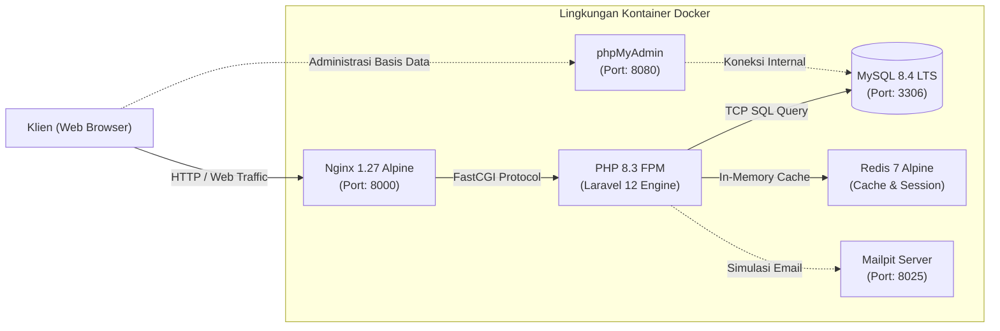

<div align="center">


# E-Surat BPKAD
### Sistem Informasi Manajemen Persuratan Digital
*Dokumentasi Portofolio Proyek Praktik Kerja Lapangan — BPKAD Kabupaten Kuningan*

[](https://laravel.com)
[](https://www.php.net)
[](https://www.mysql.com)
[](https://www.docker.com)
[](https://tailwindcss.com)
[](LICENSE)

<p align="center">
  Aplikasi berbasis web untuk digitalisasi tata kelola pengarsipan, pencatatan alur disposisi, serta monitoring Surat Masuk dan Surat Keluar pada Badan Pengelolaan Keuangan dan Aset Daerah (BPKAD).
</p>

[Ringkasan](#ringkasan-proyek) • [Latar Belakang](#latar-belakang-dan-urgensi-sistem) • [Fitur Utama](#fitur-utama) • [Arsitektur](#arsitektur-sistem) • [Panduan Penggunaan](#panduan-instalasi-dan-menjalankan-sistem) • [Pengujian](#pengujian-dan-kualitas-sistem) • [Kontak](#informasi-pengembang)

</div>

---

## Ringkasan Proyek

E-Surat BPKAD adalah aplikasi tata kelola persuratan terintegrasi yang dirancang dan diimplementasikan untuk menggantikan sistem administrasi manual konvensional di lingkungan Badan Pengelolaan Keuangan dan Aset Daerah (BPKAD) Kabupaten Kuningan. Proyek ini dikembangkan selama program Praktik Kerja Lapangan (Magang) sebagai inisiatif modernisasi administrasi pemerintahan berbasis web (*e-Government*).

Sistem dibangun menggunakan kerangka kerja Laravel 12, didukung arsitektur kontainer Docker (PHP 8.3-FPM, Nginx, MySQL 8.4 LTS, Redis, phpMyAdmin, dan Mailpit) untuk menjamin isolasi dependensi, portabilitas tinggi, serta kemudahan proses deployment.

---

## Latar Belakang dan Urgensi Sistem

Sebelum implementasi sistem ini, tata kelola persuratan operasional instansi masih berpusat pada pencatatan buku agenda fisik. Metode ini menghadapi beberapa tantangan substantif:

1. **Efisiensi Temu Kembali Berkas:** Proses penelusuran riwayat dokumen lampau membutuhkan waktu signifikan karena harus mencari lembar fisik di tumpukan ordner.
2. **Integritas dan Keamanan Dokumen:** Dokumen kertas rentan mengalami kerusakan fisik, basah, sobek, maupun salah peletakan antar bidang kerja.
3. **Visibilitas Status Tindak Lanjut:** Ketiadaan mekanisme pelacakan digital terpusat menyulitkan pimpinan dan staf dalam memantau apakah surat masuk telah dibaca, sedang diteliti, atau telah ditindaklanjuti.
4. **Penyusunan Rekapitulasi Berkala:** Pembukuan laporan bulanan dan tahunan memerlukan penghitungan manual yang memakan waktu dan rentan kekeliruan perhitungan (*human error*).

**Solusi yang Diterapkan:**
Aplikasi E-Surat BPKAD memusatkan seluruh siklus hidup surat ke dalam satu basis data terenkripsi, menyediakan fasilitas digitalisasi berkas lampiran (PDF/gambar), mesin pencarian terpadu, otomatisasi pembaruan status baca, serta generator laporan resmi berformat PDF yang siap dicetak.

---

## Fitur Utama

### 1. Dashboard Monitoring dan Analitik
- Penyajian indikator performa utama (KPI) secara terstruktur: Total Surat Masuk, Total Surat Keluar, Surat Masuk Belum Dibaca, dan Draf Surat Keluar.
- Tabel pemantauan 5 surat masuk dan 5 surat keluar paling mutakhir untuk kemudahan supervisi berkala.

### 2. Manajemen Surat Masuk
- Format pencatatan metadata lengkap: nomor berkas, tanggal penulisan surat, tanggal penerimaan dinas, instansi pengirim, perihal, dan catatan disposisi.
- Pengunggahan dan pengarsipan salinan digital dokumen fisik (mendukung ekstensi PDF, DOC, DOCX, JPG, JPEG, PNG).
- Mekanisme otomatisasi status: surat yang berstatus `belum_dibaca` akan secara otomatis diperbarui menjadi `sudah_dibaca` ketika detail surat dibuka oleh pengguna.
- Pelacakan alur hidup surat: `belum_dibaca` &rarr; `sudah_dibaca` &rarr; `diproses` &rarr; `selesai`.

### 3. Manajemen Surat Keluar
- Registrasi penomoran surat resmi keluar, instansi tujuan, tanggal penerbitan, perihal, dan berkas arsip terkait.
- Pengelolaan status dokumen keluar (`draft` dan `terkirim`).

### 4. Pencarian Terpadu (Global Search)
- Mesin pencari simultan yang memindai basis data Surat Masuk dan Surat Keluar secara paralel.
- Pencarian mencakup multi-kolom: nomor surat, instansi terkait, perihal dokumen, serta uraian keterangan.

### 5. Rekapitulasi Laporan dan Ekspor PDF
- Filter rentang periode tanggal yang fleksibel berdasarkan kebutuhan audit instansi.
- Fitur *Live Preview* tabel data laporan pada layar sebelum proses pengunduhan.
- Mesin kompilasi PDF berbasis DomPDF dengan standardisasi tata letak kop dokumen dinas resmi.

### 6. Keamanan dan Autentikasi
- Arsitektur autentikasi berbasis Laravel Breeze dengan enkripsi kata sandi Bcrypt (*work factor* 12).
- Perlindungan penuh terhadap ancaman Cross-Site Request Forgery (CSRF).
- Validasi ketat sisi server terhadap MIME-type dan batas maksimum ukuran berkas unggahan.
- Mekanisme manajemen profil dan pembaruan kredensial akun terproteksi.

---

## Arsitektur Sistem

Sistem dirancang dengan arsitektur berorientasi kontainer (*containerized architecture*) untuk memisahkan lapisan penyajian web, pemrosesan logika bisnis, dan persistensi data.



### Rincian Spesifikasi Teknologi

| Komponen | Perangkat Lunak | Versi | Peruntukan Teknis |
| :--- | :--- | :--- | :--- |
| **Backend Core** | Laravel | 12.x | Kerangka kerja aplikasi dengan arsitektur MVC dan Eloquent ORM. |
| **Runtime Lingkungan** | PHP | 8.3-FPM | Runtime backend stabil dengan kompilasi ekstensi GD, Intl, BCMath, dan OPcache. |
| **Penyimpanan Data** | MySQL | 8.4 LTS | Basis data relasional dengan integritas relasi tabel dan indeks performa tinggi. |
| **Web Server** | Nginx | 1.27 Alpine | Reverse proxy berkecepatan tinggi dengan limitasi upload 64MB dan proteksi berkas sensitif. |
| **Frontend Framework** | Tailwind CSS | 3.4 / 4.x | Kerangka kerja CSS untuk antarmuka responsif dan konsisten. |
| **Asset Bundler** | Vite | 7.x | Kompilasi aset frontend modern dengan kapabilitas Hot Module Replacement (HMR). |
| **Interaktivitas UI** | Alpine.js | 3.x | Manipulasi DOM deklaratif dan interaktivitas komponen modal. |
| **Pustaka PDF** | Barryvdh DomPDF | 3.1 | Konversi tampilan Blade HTML menjadi dokumen PDF standar dinas. |
| **Orkestrasi Server** | Docker Compose | 2.x | Otomasi deployment multi-layanan dalam jaringan terisolasi. |

---

## Panduan Instalasi dan Menjalankan Sistem

Seluruh konfigurasi lingkungan telah diotomatisasi menggunakan Docker. Tidak diperlukan instalasi PHP, Composer, Node.js, atau MySQL secara lokal pada mesin host.

### 1. Prasyarat Sistem
- Docker Engine dan Docker Compose telah terpasang pada mesin Anda.
- Utilitas `make` *(opsional, untuk menjalankan shortcut perintah operasional)*.

### 2. Kloning Repositori
```bash
git clone https://github.com/lnbakti/e-surat-bpkad.git
cd e-surat-bpkad
```

### 3. Menjalankan Kontainer
Eksekusi perintah berikut untuk memicu pembangunan dan inisialisasi lingkungan:
```bash
make up
```
*Atau menggunakan perintah Docker Compose langsung:*
```bash
docker compose up -d
```

> [!NOTE]
> Saat inisialisasi pertama kali, skrip `docker/entrypoint.sh` secara otomatis menyalin berkas environment, mengunduh dependensi Composer dan npm, membangun aset produksi Vite, menghasilkan `APP_KEY`, menghubungkan `storage:link`, dan mengeksekusi migrasi skema tabel ke MySQL.

### 4. Titik Akses Layanan (Endpoints)

| Layanan | Alamat Akses | Kredensial Default | Keterangan |
| :--- | :--- | :--- | :--- |
| **Aplikasi Utama** | [http://localhost:8000](http://localhost:8000) | **Email:** `test@example.com`<br>**Password:** `password` | Antarmuka aplikasi E-Surat BPKAD. |
| **phpMyAdmin** | [http://localhost:8080](http://localhost:8080) | **Server:** `db`<br>**User:** `root`<br>**Password:** `511040` | Antarmuka manajemen basis data. |
| **Mailpit Web UI** | [http://localhost:8025](http://localhost:8025) | *Tanpa autentikasi* | Peninjau simulasi pengiriman email lokal. |
| **Port Port MySQL** | `localhost:3306` | Sesuai kredensial phpMyAdmin | Akses langsung koneksi client eksternal (DBeaver, DataGrip). |

---

## Perintah Operasional (Makefile Reference)

Gunakan perintah shortcut berikut untuk mengelola siklus hidup aplikasi selama pengembangan atau peninjauan:

| Perintah | Deskripsi Tindakan |
| :--- | :--- |
| `make up` | Menjalankan seluruh kontainer layanan di latar belakang (*detached mode*). |
| `make down` | Menghentikan dan membersihkan seluruh kontainer yang aktif. |
| `make restart` | Memulai ulang seluruh kontainer layanan. |
| `make build` | Membangun ulang (*rebuild*) citra kontainer Docker. |
| `make logs` | Menampilkan log operasional kontainer secara langsung (*real-time*). |
| `make ps` | Memeriksa status kesehatan dan pemetaan port kontainer. |
| `make bash` | Membuka sesi terminal interaktif di dalam kontainer aplikasi. |
| `make seed` | Mengeksekusi database seeder untuk data akun uji awal. |
| `make fresh` | Mereset seluruh tabel dan mengeksekusi migrasi ulang beserta seeder. |
| `make test` | Menjalankan seluruh unit dan feature test suite PHPUnit. |
| `make vite` | Menjalankan server pengembangan Vite untuk live asset reloading. |
| `make clean` | Mengosongkan seluruh cache konfigurasi, route, dan view aplikasi. |

---

## Struktur Direktori Proyek

```text
e-surat-bpkad/
├── app/
│   ├── Http/Controllers/     # Pengendali alur logika bisnis (Surat, Laporan, Dashboard)
│   ├── Http/Requests/        # Lapisan validasi integritas data masukan
│   └── Models/               # Entitas model Eloquent (SuratMasuk, SuratKeluar, User)
├── bootstrap/                # Konfigurasi bootstrap dan inisialisasi framework
├── config/                   # Konfigurasi sistem (Basis Data, DomPDF, Autentikasi, Layanan)
├── database/
│   ├── factories/            # Definisi data tiruan untuk pengujian otomatis
│   ├── migrations/           # Skema terstruktur tabel basis data
│   └── seeders/              # Pengisian data awal sistem
├── docker/                   # Konfigurasi kustom kontainerisasi
│   ├── nginx/default.conf    # Konfigurasi virtual host server web Nginx
│   ├── php/local.ini         # Optimasi direktif runtime PHP dan OPcache
│   └── entrypoint.sh         # Skrip otomatisasi inisialisasi lingkungan kontainer
├── public/
│   ├── build/                # Berkas manifes dan kompilasi aset frontend
│   ├── images/               # Logo resmi dan aset statis instansi
│   └── index.php             # Titik masuk pemrosesan permintaan HTTP
├── resources/
│   ├── css/ & js/            # Berkas sumber gaya Tailwind CSS dan skrip JavaScript
│   └── views/                # Berkas template antarmuka Blade
├── routes/
│   ├── web.php               # Rute antarmuka pengguna web
│   └── auth.php              # Rute autentikasi akun
├── storage/                  # Direktori penyimpanan fisik berkas arsip dan log
├── tests/                    # Berkas pengujian otomatis Unit dan Feature
├── .dockerignore             # Pengecualian berkas build citra kontainer
├── .env.docker               # Template konfigurasi environment Docker tanpa rahasia
├── docker-compose.yml        # Orkestrasi layanan multi-kontainer Docker
├── Dockerfile                # Spesifikasi kompilasi citra PHP 8.3-FPM
├── Makefile                  # Otomasi perintah pengelolaan sistem
└── README.md                 # Dokumentasi teknis proyek
```

---

## Pengujian dan Kualitas Sistem

Sistem telah dilengkapi dengan rangkaian pengujian otomatis terpadu (*Automated Testing*) berbasis **PHPUnit 11** dengan isolasi basis data *in-memory* SQLite. Seluruh skenario pengujian utama (autentikasi, validasi form, hak akses, dan manajemen profil) telah diverifikasi dengan tingkat kelulusan 100%:

```bash
make test
```

```text
   PASS  Tests\Unit\ExampleTest
  ✓ that true is true

   PASS  Tests\Feature\Auth\AuthenticationTest
  ✓ login screen can be rendered
  ✓ users can authenticate using the login screen
  ✓ users can not authenticate with invalid password
  ✓ users can logout

   PASS  Tests\Feature\Auth\EmailVerificationTest
  ✓ email verification screen can be rendered
  ✓ email can be verified

   PASS  Tests\Feature\Auth\PasswordResetTest
  ✓ reset password link screen can be rendered
  ✓ password can be reset with valid token

   PASS  Tests\Feature\ProfileTest
  ✓ profile page is displayed
  ✓ profile information can be updated
  ✓ user can delete their account

  Tests:    25 passed (62 assertions)
  Duration: 1.35s
```

---

## Informasi Pengembang

Dokumentasi dan sistem ini dikembangkan oleh:

- **Nama Pengembang:** Lugas Nusa Bakti
- **Profil GitHub:** [@lnbakti](https://github.com/lnbakti)
- **Kontak Surel:** [lugasnusabakti66@gmail.com](mailto:lugasnusabakti66@gmail.com)
- **Konteks Proyek:** Praktik Kerja Lapangan (PKL) / Magang — **Badan Pengelolaan Keuangan dan Aset Daerah (BPKAD) Kabupaten Kuningan**.

---

## Lisensi

Proyek ini berada di bawah lisensi terbuka [MIT License](LICENSE).
